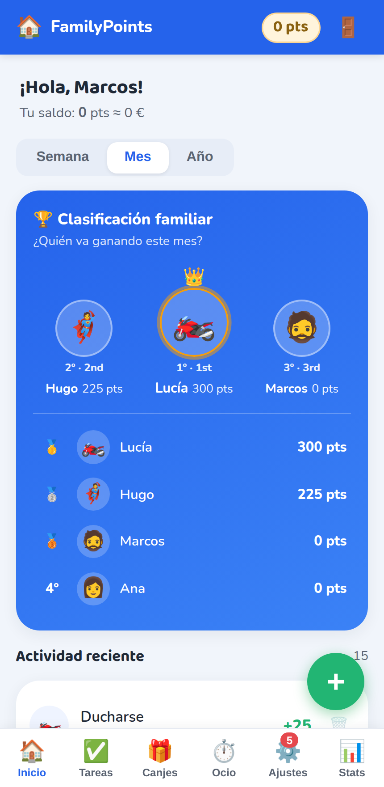
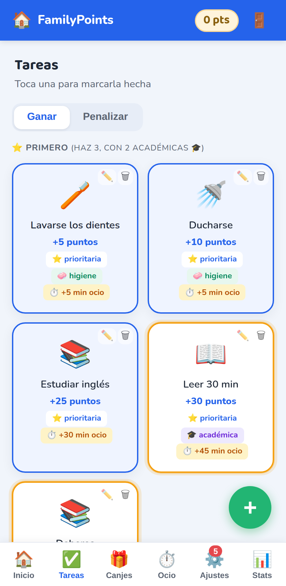
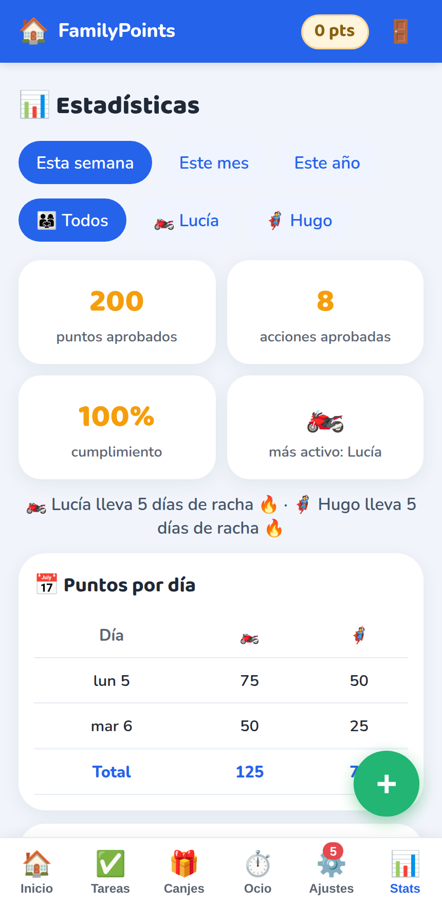

# FamilyPoints 🏆

App web (PWA instalable) para gestionar los puntos y el tiempo de pantalla de una familia.
Los hijos marcan tareas, los padres aprueban, y con los puntos se canjean cosas o minutos de ocio.
Pensada para usarse **desde el móvil, instalada como app** y sin depender de ninguna nube.

Capturas reales de la app con la familia de ejemplo (`docs/capturas/`):

| Inicio | Tareas | Estadísticas |
|---|---|---|
|  |  |  |

## Qué hace

- **Tareas con puntos** (positivos y negativos), marcadas por el hijo y **aprobadas por un padre**.
  Ningún punto cuenta hasta que lo aprueba un adulto.
- **Reglas de juego configurables** en el servidor, no en el móvil:
  - "Regla dura": un hijo no puede marcar una tarea de casa si antes no ha hecho **3 prioritarias
    (2 de ellas académicas)** ese día.
  - Tareas de **higiene** exentas de la regla (ducharse, dientes…), límite diario de la botella de
    agua, y exclusión mutua ("si uno pone la mesa, el otro la recoge").
- **Ocio como moneda aparte**: al aprobar una tarea se ganan puntos **y minutos** de pantalla.
  Gastarlos es una **petición** del hijo que el padre aprueba (tv / móvil / consola / play).
- **Canjes** en 3 fases (`propuesto → tasado → aprobado → entregado`) para separar "lo que quiero"
  de "lo que ya he recibido".
- **Reparto de roles real**: los padres aprueban, tasan, entregan, sancionan y editan; los hijos
  marcan tareas y proponen canjes. Un padre **no puede aprobar su propio canje**: lo revisa el otro.
- **Cada hijo ve solo lo suyo** (sus puntos y su tiempo). El ranking completo y las estadísticas
  son solo para los padres, para que no se genere rivalidad entre hermanos.
- **Panel de estadísticas** (padres): puntos por día, cumplimiento, rachas, desglose por tarea y
  categoría. Sin librerías de gráficos: SVG a mano, para que funcione offline.
- **Avisos por Telegram** al padre cuando hay algo que aprobar (una sola línea de resumen).
- **Backups** automáticos de la base de datos (API `backup()` de SQLite, segura con WAL y en caliente).

## Stack

- **Backend**: Flask + SQLite (WAL). Un solo fichero: `app.py`.
- **Frontend**: HTML/CSS/JS sin frameworks, service worker propio (PWA instalable, offline).
- **Notificaciones**: Bot API de Telegram (opcional, se configura desde la app).
- **Tests**: `tests/test_reglas.py` — 10 tests de regresión que **nunca tocan la base real**
  (base temporal + cliente de test de Flask).
- Sin dependencias de frontend, sin CDN, sin cookies de terceros.

## Arrancar en local

```bash
python3 -m venv .venv && source .venv/bin/activate
pip install flask

mkdir -p data
python seed.py            # crea la familia de EJEMPLO y tareas de muestra
python app.py             # http://127.0.0.1:8890
```

Familia de ejemplo del `seed.py` (cámbiala antes de usar esto en casa):

| Miembro | Rol | PIN |
|---|---|---|
| Marcos | padre | 1234 |
| Ana | padre | 4321 |
| Lucía | hija | 1111 |
| Hugo | hijo | 2222 |

Variables de entorno: `FAMILYPOINTS_PORT` (8890), `FAMILYPOINTS_HOST` (0.0.0.0),
`FAMILYPOINTS_HTTPS` (para servir con certificado propio y que el móvil lo instale como PWA).

Tests:

```bash
.venv/bin/python tests/test_reglas.py
```

Como servicio (systemd): `familypoints.service` es una plantilla; ajusta rutas y usuario.
Los backups periódicos se hacen con `scripts/backup_db.py` (retención de 14 copias).

## Notas de seguridad

- Los PIN se guardan **hasheados** (SHA-256), y hay que cambiarlos desde la app: los del `seed.py`
  son de ejemplo y son triviales.
- La app está pensada para la **red de casa**. Si la expones a internet, pon HTTPS y una capa de
  autenticación delante.
- El token del bot de Telegram se guarda en la tabla `settings` de la BD: la BD **no debe
  publicarse ni subirse a ningún sitio**.

## Sobre este proyecto

Lo diseñé yo (reglas de negocio, roles, qué se aprueba y qué no) y el código lo construí
con agentes de IA: no vengo del mundo técnico, vengo de vender y de dirigir equipos, y esto es
la prueba de hasta dónde llego montando herramientas para un problema que tengo en casa cada día.
